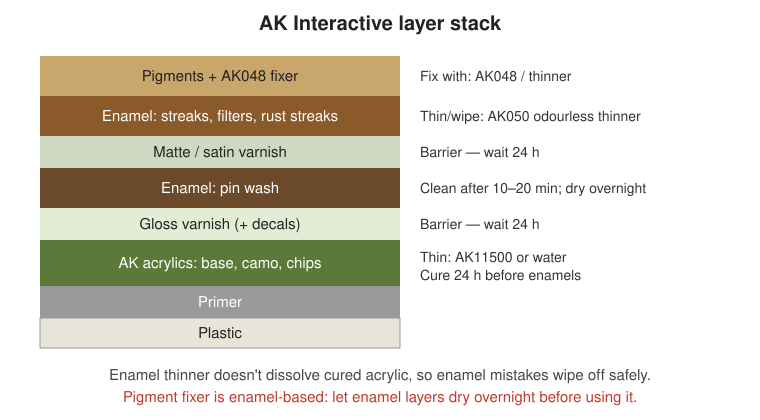

# Working with AK Interactive Acrylics, Enamels and Pigments

This guide assumes your kit is **AK Interactive acrylics** (3rd Generation or the older
standard range), **AK Interactive enamel weathering products** (washes, streaking and fluid
effects) and **AK Interactive pigments**. It shows how to combine them without one product
damaging another, what to thin and clean each with, and step-by-step recipes.

For the general techniques see the [main painting guide](painting-guide.md); for preparing
polystyrene, PLA, PETG or Lexan see [Painting by Material](painting-by-material.md).

Product codes are given only where I confirmed them against retailer listings. Others are named
by their label text — AK renames and renumbers lines from time to time, so check the bottle.

## Contents

1. [What you have and how it behaves](#1-what-you-have-and-how-it-behaves)
2. [The one rule: acrylic underneath, enamel on top](#2-the-one-rule-acrylic-underneath-enamel-on-top)
3. [Thinners and cleaners](#3-thinners-and-cleaners)
4. [Using AK acrylics](#4-using-ak-acrylics)
5. [Using AK enamel washes and effects](#5-using-ak-enamel-washes-and-effects)
6. [Using AK pigments](#6-using-ak-pigments)
7. [Full workflow with drying times](#7-full-workflow-with-drying-times)
8. [Recipes](#8-recipes)
9. [Mistakes and how to fix them](#9-mistakes-and-how-to-fix-them)
10. [What to add to your kit](#10-what-to-add-to-your-kit)
11. [Sources](#11-sources)

---

## 1. What you have and how it behaves

| Product family | Base | Thin with | Dries | Re-activated by |
|---|---|---|---|---|
| AK acrylics (3rd Gen, standard, AFV/Air series) | Water | AK11500 Acrylic Thinner, or a little water for brushing | 10–30 min touch-dry, ~24 h fully cured | Water while fresh; IPA or acrylic cleaner once cured |
| AK enamel washes, filters, streaking and fluid effects | Solvent (white spirit) | AK011 White Spirit, AK050 Odourless Thinner, AK049 Odourless Turpentine | 1–2 h workable, 24 h hard | White spirit / odourless thinner — **for days** |
| AK pigments (dry powders) | — | Fixed with AK048 Pigment Fixer (enamel-based), white spirit, or acrylic varnish | Fixer dries in ~1–2 h | Fixer and thinners wet them again |

The key point: **enamel thinner does not dissolve cured acrylic**, but **acrylic products do not
re-wet enamel**. That difference is what lets you wipe and blend weathering on top of a finished
acrylic paint job.

## 2. The one rule: acrylic underneath, enamel on top

- Paint everything you want permanent (base colours, camouflage, details, chipping) in **acrylic**.
- Let acrylics cure **at least 24 hours** before any enamel goes on. Freshly dried acrylic can
  still be softened and lifted by vigorous scrubbing with white spirit.
- A **varnish layer** between the two (gloss before washes, matte before most weathering) is cheap
  insurance and makes washes flow and wipe much better.
- Do your **enamel** washes, filters and streaks next. Mistakes are wiped off with a brush damp
  with odourless thinner — the acrylic underneath is not affected.
- **Pigments come last.** AK048 Pigment Fixer is enamel-based, so it will re-wet any enamel
  layers it touches. Let enamel work dry overnight first, and apply fixer sparingly.
- If you need **acrylic after enamel** (more chips, a correction), wait until the enamel is dry
  (overnight), then brush acrylic on — it sits on top fine. For safety, seal with an acrylic
  varnish first.

**Never** wipe acrylic weathering with white spirit expecting it to move, and never apply enamel
over enamel and then scrub hard the same day — you'll pull up both layers.

## 3. Thinners and cleaners

| Job | AK product | Alternative |
|---|---|---|
| Thin acrylics for airbrush | AK11500 Acrylic Thinner (3rd Gen) | Distilled water + a drop of flow improver (more tip-dry) |
| Thin acrylics for brush | A drop of water or AK11500 | — |
| Clean airbrush after acrylics | AK11505 Perfect Cleaner | IPA, airbrush cleaner |
| Thin / blend / remove enamels | AK050 Odourless Thinner (gentlest, least smell) or AK049 Odourless Turpentine | Artist's odourless mineral spirit (e.g. Winsor & Newton Sansodor) |
| Stronger enamel thinner, brush cleaning | AK011 White Spirit | Hardware-store white spirit |
| Fix pigments | AK048 Pigment Fixer | White spirit or odourless thinner; matte acrylic varnish for an acrylic route |

**Thinner (AK11500) and cleaner (AK11505) are different products** — don't thin paint with the
cleaner. AK11500 is for water-based acrylics only, not AK Xtreme Metal (solvent-based).

**Odourless thinner is the default for weathering.** It's slower and gentler than white spirit,
so washes stay workable longer and it is less likely to attack the layer below.

## 4. Using AK acrylics

### Brush

- Shake well (add an agitator ball if the bottle doesn't have one); AK 3rd Gen pigment settles.
- Put a few drops on a **wet palette**; add water or AK11500 drop by drop until the paint flows
  but still covers.
- Two or three thin coats; let each dry.

### Airbrush

- Starting ratio about **1 part AK11500 to 2–3 parts paint**, around **15–20 psi**.
  Users report wide variation by colour — some need only a few drops of thinner, some much more —
  so test-spray on card and aim for milk consistency.
- If you get tip-dry or spatter: clean the needle tip, lower the ratio of paint to thinner
  slightly, spray a little closer at lower pressure. A drop of retarder/flow improver helps.
- Clean between colours with AK11505 Perfect Cleaner; strip and clean fully after each session —
  cured acrylic in the nozzle is the most common cause of AK clogging complaints.

### Primer

Prime with any primer from the [main guide](painting-guide.md#4-primer). AK also makes its own
acrylic primers. A lacquer primer (Tamiya Fine Surface Primer, Mr. Surfacer) under AK acrylics is
the toughest combination and is the best choice for PETG or other slick plastics.

### Varnish

Use an acrylic varnish (AK makes gloss, satin and matte; any acrylic varnish works). Spray or brush
thin coats; let cure 24 h before enamel weathering.
See [Clear Top Coats](clear-coats.md) for the final seal over weathering.

## 5. Using AK enamel washes and effects

AK's enamel line includes:

- **Washes** — e.g. "Dark Brown Wash for Green Vehicles", "Wash for NATO Camo", "Wash for
  Interiors", "Track Wash", "Wash for Wood". Used as pin washes in recesses or overall washes.
- **Filters** — very thin translucent colours to shift tone.
- **Streaking products** — "Streaking Grime", "Rust Streaks", "Winter Streaking Grime",
  "Rainmarks".
- **Fluid effects** — "Fuel Stains", "Engine Oil", "Oil Stains" (gloss for wet/fresh).
- **Earth and mud effects** — enamel textures and splashes.

### Pin wash

1. Over a **gloss** varnish, touch a fine brush loaded with wash into panel lines and around
   detail.
2. Wait **10–20 minutes**.
3. Clean the excess with a flat brush or cotton bud **barely damp** with AK050 Odourless Thinner,
   stroking downward (gravity) or in the direction of airflow.

### Overall wash / filter

1. Over a **satin or matte** varnish, brush the product over a whole panel, thinned with odourless
   thinner (filters: very thin, about 1:3 or more).
2. Blend out tide marks while still wet with a clean, damp brush.

### Streaks

1. Dot or draw thin vertical lines of Streaking Grime or Rust Streaks under rivets, hatches and
   edges.
2. Leave **5–15 minutes**, then drag downwards with a thin brush damp with thinner until only
   faint streaks remain. Leave more product to make heavier stains.

### Fluid stains

Apply Fuel Stains / Engine Oil **last** (even after pigments) with a fine brush around filler caps,
engine decks and joints. Use neat for wet and fresh; thin and blend for old stains.

## 6. Using AK pigments

### Three ways to fix them

| Method | How | Result |
|---|---|---|
| **AK048 Pigment Fixer** (enamel) | Place pigment dry, then touch fixer to the edge so it wicks in | Durable; slight darkening; won't disturb acrylic, *will* disturb fresh enamel |
| **Thinner** (AK050 / AK011) | Mix pigment into a slurry or wick thinner into dry pigment | Softer, subtler bond; can be redistributed later |
| **Dry, no fixer** | Rub pigment on with a stiff brush over **matte** varnish | Most natural dust; easily rubbed off by handling |

### Tips

- Pigments **only stick to matte surfaces**. Spray a matte varnish first.
- Apply sparingly; build up. Excess can be removed with a dry brush before fixing.
- Mix pigments with an enamel wash or effect to make mud splashes and caked earth.
- Pigments dry lighter than they look wet — judge colour once dry.
- Dust mask when handling loose powder; don't blow it around.

## 7. Full workflow with drying times

| # | Step | Product type | Then wait |
|---|---|---|---|
| 1 | Prime | Lacquer or acrylic primer | 1 h (lacquer) / 24 h (acrylic-poly) |
| 2 | Base colour, camo, details | AK acrylics | 30 min between coats; **24 h** before step 4 |
| 3 | Acrylic chipping (sponge/brush) | AK acrylics | 1 h |
| 4 | Gloss varnish | Acrylic gloss | **24 h** |
| 5 | Decals + set + seal with gloss | Acrylic gloss | 24 h |
| 6 | Pin wash | AK enamel wash + odourless thinner | Clean after 10–20 min; dry **overnight** |
| 7 | Satin/matte varnish | Acrylic | 24 h |
| 8 | Filters, streaks, rust streaks | AK enamel effects | Overnight |
| 9 | Matte varnish (optional seal) | Acrylic | 24 h |
| 10 | Pigments — dust, mud, rust | AK pigments + AK048 fixer | 1–2 h |
| 11 | Fresh fluids — fuel, oil | AK enamel fluids | — |

You can compress the schedule by working on other parts while layers cure, but don't skip the
overnight dry before pigments go on top of enamels.

## 8. Recipes

### A. Armour / vehicle (green, lightly weathered)

1. Prime grey or black; AK acrylic base green, lighter green mottled on upper panels.
2. Sponge-chip with an acrylic dark brown, then add a few lighter-green edges.
3. Gloss varnish → pin wash with "Dark Brown Wash for Green Vehicles" → clean with AK050.
4. Matte varnish → "Streaking Grime" on vertical faces, drag down with thinner.
5. Pigments: light dust on lower hull and running gear, fixed with AK048 near the bottom only.
6. Engine Oil / Fuel Stains around filler caps and engine deck.

### B. Rust (old steel, shipwreck, scrap)

1. Prime oxide red or dark brown.
2. AK acrylic rust mottle: dark brown base, sponge orange-brown and light ochre patches.
3. Optional: hairspray or chipping fluid + acrylic top colour, scrubbed back (see
   [main guide](painting-guide.md#chipping)).
4. Matte varnish → "Rust Streaks" (enamel) from bolts and edges, dragged down.
5. Rust pigments (dark and light shades) in recesses and on horizontal surfaces, fixed with AK048.
6. Highlight sharp edges with graphite pencil or dark metal pigment for worn steel.

### C. Verdigris (bronze statue, copper fittings)

1. Black primer; AK acrylic bronze or copper metallic.
2. Pin-wash recesses with a dark brown enamel wash; let dry overnight.
3. Brush **AK19313 Verdigris Wash** (acrylic, slow drying) into recesses and down from raised
   detail; blend with a damp brush. Note: this one is **acrylic**, so clean up with water, not
   white spirit.
4. Optionally dust light blue-green pigment into deep recesses and fix.
5. Re-highlight the highest points with the metallic.
6. Alternative: the AK11265 Verdigris Effect Set (Bronze Effect paint AK11267 + oxidising agent)
   grows real verdigris chemically — test on scrap first.

### D. PLA 3D print (terrain or display piece)

1. Sand and filler-prime (see [Painting by Material](painting-by-material.md#3-pla-3d-prints)).
2. AK acrylic base colours; dry-brush highlights in acrylic.
3. Gloss or satin varnish → enamel wash to pick out the detail and print texture.
4. Matte varnish → pigments for earth and dust, fixed with AK048.

PLA handles AK050/AK011 fine once primed and painted; don't soak bare PLA with thinner.

## 9. Mistakes and how to fix them

| Problem | Cause | Fix |
|---|---|---|
| Wash removed the base colour | Acrylic not cured, or scrubbing with white spirit | Wait 24 h; varnish first; use AK050 and light pressure |
| Wash stains whole panels, won't wipe | Applied over matte paint | Gloss varnish before pin washes |
| Tide marks from filters | Too much thinner, uneven drying | Blend edges wet; thinner filters, several passes |
| Pigment fixer lifted my streaks | Enamel underneath wasn't dry | Let enamels dry overnight or seal with matte varnish first |
| Pigment disappeared/darkened | Too much fixer | Apply less; add a little dry pigment over the top once dry |
| Pigment won't stick | Surface glossy | Matte varnish first |
| Airbrush spits AK acrylic | Tip-dry, wrong thinning | Clean tip, adjust thinner ratio, lower pressure, add retarder |
| Too much weathering | It happens | Enamels: wipe with thinner while fresh. Pigments: dry brush off. Otherwise repaint the panel |

## 10. What to add to your kit

If you don't already have them:

- **AK11500 Acrylic Thinner** and **AK11505 Perfect Cleaner** (if airbrushing).
- **AK050 Odourless Thinner** (main weathering thinner) and **AK011 White Spirit** (stronger,
  for brush cleaning).
- **AK048 Pigment Fixer**.
- **Acrylic gloss and matte varnish** — the barriers that make the whole system work.
- A **wet palette**, flat and round brushes reserved for enamels (don't share brushes between
  acrylics and enamels without cleaning thoroughly), cotton buds, and a dust mask and gloves.

## 11. Sources

Compiled from general modelling practice and these references (accessed November 2026):

- AK11500 Acrylic Thinner — [Feroca](https://feroca.com/en/paints-and-primers/1604-acrylic-thinner-100-ml-3gen.html), [BNA Model World](https://www.bnamodelworld.com/hobby-model-paints/ak-interactive-ak-11500-acrylic-thinner-100ml-3rd-generation)
- AK048 Pigment Fixer — [BNA Model World](https://bnamodelworld.com/ak-interactive-ak-048-pigment-fixer-enamel-fluid-35ml), [PB Tech](https://www.pbtech.co.nz/product/PNTAKN0048/AK-Interactive-AK048-Enamel-Fluid---Pigment-Fixer)
- AK049 Odourless Turpentine — [BNA Model World](https://bnamodelworld.com/ak-interactive-ak-049-odorless-turpentine-thinner-for-enamel-paints-35ml)
- AK011 White Spirit — [Scale Model Shop](https://www.scalemodelshop.co.uk/ak-interactive-white-spirit-ak011)
- Airbrushing AK 3rd Gen — [Sunward Hobbies](https://sunwardhobbies.ca/content/how-to-airbrush-ak-3g-acrylic-paint), [Kitmaker forum](https://forums.kitmaker.net/t/issues-airbrushing-ak-interactive-3rd-generation/4981), [FineScale forum](https://forum.finescale.com/t/new-ak-3rd-generation-afv-paints-helpful-tips/256224), [Tale of Painters review](https://taleofpainters.com/2024/04/review-ak-3rd-generation-acrylics-the-new-color-punch-paints/)
- AK verdigris products — see the [main guide's sources](painting-guide.md#16-sources-and-further-reading)
