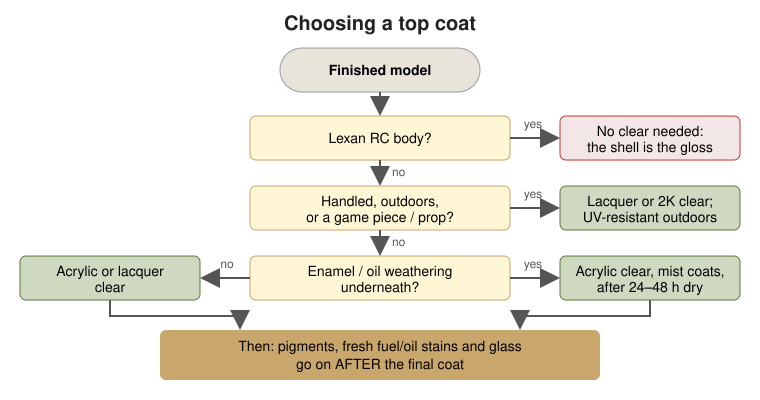

# Sealing Finished Work: Clear Top Coats

A clear top coat protects paint from handling, evens out the sheen, and blends decals and
weathering into one finish. Done wrong, it can frost white, wipe out pigments or wrinkle the
layers below. This guide covers choosing a varnish, applying it, sealing weathered models, and
the extra options for handled or outdoor 3D prints.

Related guides: [main painting guide](painting-guide.md) ·
[Painting by Material](painting-by-material.md) ·
[AK Interactive workflow](ak-interactive-workflow.md)

## Contents

1. [Choosing a sheen](#1-choosing-a-sheen)
2. [Types of clear coat](#2-types-of-clear-coat)
3. [Products](#3-products)
4. [Which clear goes over what](#4-which-clear-goes-over-what)
5. [How to apply](#5-how-to-apply)
6. [Sealing weathered models and pigments](#6-sealing-weathered-models-and-pigments)
7. [Mixed sheens on one model](#7-mixed-sheens-on-one-model)
8. [Heavy-duty sealing: handled parts, outdoor items and 3D prints](#8-heavy-duty-sealing-handled-parts-outdoor-items-and-3d-prints)
9. [Lexan bodies](#9-lexan-bodies)
10. [Problems and fixes](#10-problems-and-fixes)
11. [Recommended setups](#11-recommended-setups)
12. [Safety](#12-safety)
13. [Sources](#13-sources)

---

## 1. Choosing a sheen

| Sheen | Looks like | Use for |
|---|---|---|
| **Gloss** | Wet, shiny | Cars, new aircraft, wet surfaces; **under** decals and washes |
| **Satin / semi-gloss** | Soft sheen | Most military vehicles, modern aircraft, figures' leather/boots, ships |
| **Matte / flat** | No shine | Military armour, WWII aircraft, uniforms, terrain, miniatures |
| **Ultra-matte** | Chalky, dead flat | Figures, terrain, dusty vehicles |

Scale effect: shine looks exaggerated at small scale, so most models look more realistic slightly
flatter than the real thing. Matte varnish also dulls **metallics** — mask them off or touch them
up after varnishing.

## 2. Types of clear coat

| Type | Strength | Pros | Cons |
|---|---|---|---|
| **Acrylic (water-based)** | Moderate | Low odour, safe indoors, won't disturb dry enamel weathering | Softer; matte versions can frost if laid on thick; needs mixing well |
| **Lacquer (solvent)** | Hard | Very durable, smooth, levels well, fast drying | Strong fumes; can **attack enamel and acrylic** layers if sprayed wet; temperature/humidity sensitive |
| **Enamel / oil-based** (artist varnish, some spray cans) | Moderate | Hard, slow levelling | Slow drying; can yellow; re-wets enamel weathering |
| **2K urethane** (two-part, aerosol or airbrush) | Very hard | Abrasion, chemical and UV resistant — the car-body finish | Contains isocyanates — **respirator and ventilation essential**; long cure; pot life once activated |
| **Epoxy coatings** (XTC-3D, Loctite 3D High Gloss Coat) | Very hard | Thick, self-levelling, impact resistant | Fills detail; yellows in sunlight; gloss only (matte it with a top coat) |

## 3. Products

Products by type. Check current availability locally; ranges and codes change.

**Acrylic — spray can**
- Mr. Hobby **Mr. Premium Top Coat** (Flat, Gloss) — water-based; widely rated the smoothest,
  most consistent (but small, costly cans).
- AK Interactive **Matt Varnish** spray (AK1013) and **Ultra Matte** varnish; AMMO **Lucky
  Varnish** (matte/satin/gloss).
- Citadel Munitorum Varnish, Army Painter Anti-Shine (miniatures).

**Acrylic — airbrush / brush**
- Vallejo Matt / Satin / Gloss Varnish, Vallejo Mecha Varnish, AK Ultra Matte, AMMO Lucky Varnish,
  Tamiya X-22 (gloss) and XF-86 (flat).
- Thin coats through the airbrush (many are ready to spray or need 10–20% thinner).

**Lacquer — spray can / airbrush**
- Mr. Hobby **Mr. Super Clear** (Gloss, Flat, and **UV Cut** versions that add UV protection),
  Mr. Color GX100 / GX112 / GX113.
- Tamiya **TS-13** Clear, **TS-80** Flat Clear, **TS-79** Semi-Gloss Clear; Tamiya LP clears.
- Testors **Dullcote** / Glosscote (lacquer; users note the rattle-can Dullcote dries closer to
  satin; availability varies by country).
- Alclad II Klear Kote (gloss, semi-matte, flat).

**Artist and general varnish (larger work, terrain, props)**
- Winsor & Newton, Liquitex or Golden spray varnishes (with UV protection) — matte, satin, gloss.
- Krylon Matte Finish / UV-Resistant Clear.

**Heavy duty**
- 2K urethane aerosols: SprayMax 2K Clear, Würth 2K Clear Coat, Stardust 2K clears (gloss/matte).
- Epoxy: Smooth-On XTC-3D, Loctite 3D Printing High Gloss Coat.
- PETG/print-specific UV coatings (e.g. Siraya Tech PETG coating).

## 4. Which clear goes over what

Follow the same rule as paint: **the top coat's solvent must not attack what's underneath.**

| Underneath | Acrylic clear | Lacquer clear | 2K urethane |
|---|---|---|---|
| Acrylic paint | ✅ Safe | ⚠️ Mist coats only, test first | ⚠️ Mist first coat, test |
| Lacquer paint | ✅ Safe | ✅ Safe | ✅ Safe |
| Enamel paint / enamel weathering (dry **24–48 h**) | ✅ Safe once dry | ⚠️ Only after full cure, light mist coats | ⚠️ Test first |
| Oil paint weathering (dry several days) | ✅ Safe once dry | ⚠️ Light mist coats | ⚠️ Test first |
| Loose pigments | ⚠️ Dulls and darkens them — see §6 | ⚠️ Same | ❌ Avoid |
| Decals | ✅ Safe | ⚠️ Can wrinkle some decals if wet | ⚠️ Test |
| Metal powders, graphite | ⚠️ Kills the shine — apply after varnish | ⚠️ Same | ⚠️ Same |

For an **AK Interactive** acrylic + enamel kit: use an **acrylic varnish** (AK, AMMO Lucky, Vallejo,
Mr. Premium Top Coat) over the finished model. It won't disturb dried enamel washes and streaks.

## 5. How to apply

### Prepare

- Let everything cure: acrylics 24 h, enamel weathering 24–48 h, oils several days.
- Remove dust with a soft brush or blower; handle with gloves.
- Mask clear parts (canopies, lights), bare metal and anything that should stay glossy.
- Work at **18–25 °C** and below about **65 % humidity**. Avoid damp or cold days for spray cans.
- **Mix matte varnish thoroughly** — the flattening agent settles, and an unstirred bottle gives
  patchy or frosted results. Shake cans for at least a minute.

### Spray can

1. Warm the can in warm (not hot) water in cool weather.
2. Hold about 25–30 cm away; start spraying off the model and pass across in one sweep.
3. **Mist coat first** — light, almost dry. Let it flash for 5–10 minutes.
4. Two or three more light coats until the sheen is even. Don't try to cover in one wet coat.
5. Leave 24 h before handling (lacquers dry faster; 2K and epoxy longer).

### Airbrush

- 15–20 psi, 10–15 cm away, light passes. Thin acrylic varnish slightly with its own thinner.
- For matte: several thin coats beat one heavy one — thick matte frosts.
- Clean the airbrush promptly; varnish hardens in the nozzle.

### Brush (small models, touch-ups)

- Use a soft, wide flat brush; brush-on varnishes (Vallejo, AK, Citadel) level better if slightly
  thinned.
- Apply one thin coat in one direction, don't go back over it while drying.
- Brush matte varnish can streak; satin is more forgiving by brush.

## 6. Sealing weathered models and pigments

Varnish changes weathering: matte varnish over pigments tends to dull, darken or "melt" them into
the surface. Choose one of these strategies:

1. **Varnish before the pigments (recommended).** Finish washes, filters and streaks → matte
   varnish → apply pigments and fix them with pigment fixer (AK048) or thinner → **no varnish on
   top**. Pigments stay vivid; fixer holds them for normal display.
2. **Very light mist over pigments.** If the model will be handled, spray one *very* light, dry
   mist of matte acrylic from further away (30–40 cm for a can). Let dry, then brush a little dry
   pigment back on where the effect faded.
3. **Varnish, then re-weather.** Seal everything, then repeat a final light pass of pigment
   and fluid stains on top.

Fresh fuel and oil stains, wet mud and glass should go on **after** the final matte coat so they
stay glossy.

Always test on a scrap part or the model's underside first.

## 7. Mixed sheens on one model

- **Overall coat** in the dominant sheen (often matte or satin).
- **Mask** canopies, headlights and glossy panels before spraying; or touch them up after with
  brush-on gloss.
- **Gloss details** by brush after: wet mud, oil stains, eyes on figures, leather boots, glass.
- **Metallics:** mask, or re-polish with metal powder/graphite after the matte coat.

## 8. Heavy-duty sealing: handled parts, outdoor items and 3D prints

Display models need only a hobby varnish. For game pieces, props, cosplay, toys or anything
outdoors:

- **Handled items:** 2–3 coats of a hard lacquer clear (Mr. Super Clear, Tamiya TS) over a cured
  paint job, or an acrylic varnish followed by a lacquer top coat (mist first).
- **Maximum toughness:** 2K urethane clear (SprayMax, Würth). Wear a respirator rated for
  isocyanates (A2P3 at minimum; ideally fresh-air), spray outdoors, follow the can's cure times
  (often many hours per coat at 20 °C).
- **Outdoors / sunlight:** use a **UV-resistant** clear (Mr. Super Clear UV Cut, Krylon
  UV-Resistant Clear, 2K automotive clear). **Uncoated PETG can yellow and become brittle under
  long UV exposure**; PLA softens in hot sun (~55 °C), so even sealed PLA isn't ideal outdoors.
- **Epoxy (XTC-3D etc.)** is a smoothing/strength coat, best **under** the paint. If used as a
  top coat, cover it with a UV-resistant clear — epoxy yellows in sunlight.
- 3D-print-specific clears (Stardust 3D Clearcoat, Siraya coatings) are an option for prints that
  aren't painted.

## 9. Lexan bodies

The polycarbonate shell is already the clear "top coat" — the paint is on the inside. Don't spray
ordinary clears on the outside; they can crack as the body flexes. To protect decals, use a clear
sold for polycarbonate (Spaz Stix, Pro-Line or Tamiya PS clears), or just leave decals bare.
See [Painting by Material](painting-by-material.md#5-lexan--polycarbonate).

## 10. Problems and fixes

| Problem | Cause | Fix |
|---|---|---|
| **Frosting / white haze** | High humidity, thick matte coat, varnish not mixed, spraying over partly dry varnish | Wait for dry weather; spray a **gloss** coat over it (often clears it), then a thinner matte coat. Lacquer frosting can sometimes be cleared with a light mist of Mr. Leveling Thinner |
| Patchy sheen | Unmixed varnish, uneven coats | Stir/shake longer; another even, light coat |
| Wrinkling, crazing | Lacquer clear over uncured acrylic/enamel | Let it cure; strip and repaint the panel; use acrylic clears next time |
| Pigments disappeared | Varnish over loose pigment | Re-apply dry pigment; varnish before pigments next time |
| Orange peel / runs | Too close, too wet | Sand smooth with 2000–3000 grit when hard, re-coat lightly |
| Too shiny | Rattle-can "flat" dries satin | Add a coat of a true ultra-matte varnish |
| Tacky for days | Cold, thick coat, enamel underneath not dry | Warm, dry room; time; thinner coats |
| Yellowing | Oil varnish or epoxy in sunlight | Use UV-resistant acrylic or lacquer clears |
| Dust in the finish | Dirty surroundings | Spray in a booth or still room; sand nibs out with 3000 grit and re-coat |

## 11. Recommended setups

**Display models with AK acrylics + enamels (your current kit)**
- Gloss: Tamiya X-22 or Mr. Premium Top Coat Gloss under decals/washes.
- Final: AK Ultra Matte, AMMO Lucky Varnish or Mr. Premium Top Coat Flat, sprayed in mist coats.
- Pigments after the final coat, fixed with AK048.

**Toughest hobby finish**
- Mr. Super Clear (lacquer) or Tamiya TS clears over cured paint, mist first.

**Handled or outdoor 3D prints**
- Prime → paint → 2K clear (respirator) or UV-resistant clear.

## 12. Safety

- Spray outdoors or in an extracted spray booth.
- Respirator with organic vapour cartridges and particulate filter (A2P3) for any spray clear;
  2K products contain isocyanates — follow the manufacturer's PPE guidance strictly.
- Clears are flammable; no naked flames, and store cans away from heat.

## 13. Sources

Compiled from general modelling practice and these references (accessed November 2026):

- Tale of Painters — [The 5 best matt varnishes](https://taleofpainters.com/2023/02/video-review-the-5-best-matt-varnishes-for-warhammer-miniatures-spray-airbrush-ultra-matt/)
- Tista Minis — [Guide to miniature varnishes and sealants](https://tistaminis.com/blogs/blog/the-ultimate-guide-to-miniature-varnishes-and-sealants)
- Scale Model Shop — [Clear coat: gloss, satin or matt?](https://www.scalemodelshop.co.uk/clear-coat-for-miniatures/)
- Pro Scale Hobbies — [Varnishing in scale modelling](https://proscalehobbies.pages.dev/articles/varnishing-in-scale-modelling/)
- FineScale — [All about washes](https://finescale.com/how-to/articles/2025/10/all-about-washes/)
- FineScale forum — [Varnish, panel lines and weathering with enamel paints](https://forum.finescale.com/t/varnish-panel-lines-weathering-with-enamel-paints/241095)
- FineScale forum — [What to finish fighter planes with?](https://forum.finescale.com/t/what-to-finish-fighter-planes-with/249819)
- Armorama — [Varnish and weathering](https://armorama.kitmaker.net/features/1501)
- Fusion Scale Hobbies — [AMMO Lucky Varnish](https://fusionscalehobbies.com/collections/ammo-varnish)
- Stardust Colors — [3D clearcoat](https://stardustcolors.co.uk/acrylic-3d-printing-paint-primers-colors-and-clearcoat/1790-3d-clearcoat-gloss-matt.html)
- Siraya Tech — [PETG coating](https://siraya.tech/collections/petg-coating)
- Würth — [Clear Coat](https://shop.wurthindustry.com/products/wurth-clear-coat-12-clear-coat-12fl-oz-24-unit-pack)
- Smooth-On — [XTC-3D](https://www.smooth-on.com/products/xtc-3d/)
- Henkel — [Loctite 3D Printing High Gloss Coat](https://www.henkel-adhesives.com/at/en/product/protective-coatings/loctite_3d_printinghighglosscoat.html)
