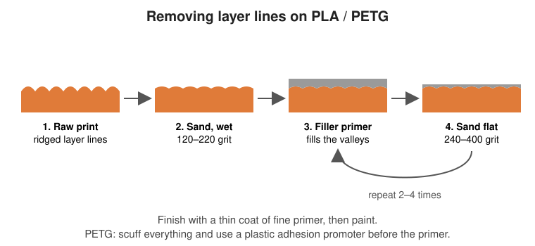
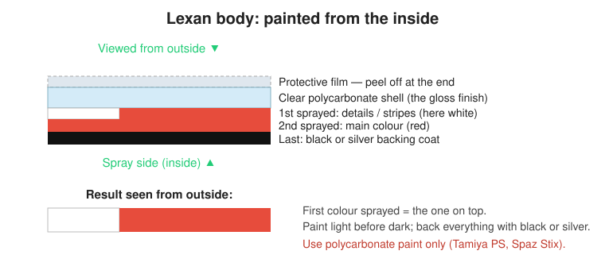

# Painting by Material: Polystyrene, PLA, PETG and Lexan

Each plastic needs different preparation, primer and paint. This guide covers the four most
common materials for model makers:

| Material | What it is | Typical use | Paint sticks? | Key difficulty |
|---|---|---|---|---|
| **Polystyrene (styrene)** | The hard plastic of injection-moulded kits | Airfix, Tamiya, Revell, Eduard kits; Evergreen/Plastruct sheet | Well, once cleaned and primed | Mould release, seams |
| **PLA** | The most common FDM 3D-printing filament | Printed models, terrain, props, miniatures | Fairly well | Layer lines; heat-sensitive |
| **PETG** | Tougher, slightly flexible, glossy FDM filament | Functional printed parts, outdoor items | **Poorly** | Slick surface; adhesion |
| **Lexan (polycarbonate)** | Clear, flexible sheet, vacuum-formed | RC car bodies, canopies, clear covers | Only with flexible paint made for it | Flexes, so rigid paint cracks; painted from the inside |

For the painting and weathering techniques themselves (washes, chipping, rust, verdigris) see
the [main painting guide](painting-guide.md). This page is about getting the paint to stick and
look right on each material.

## Contents

1. [Rules that apply to every material](#1-rules-that-apply-to-every-material)
2. [Polystyrene kit plastic](#2-polystyrene-kit-plastic)
3. [PLA 3D prints](#3-pla-3d-prints)
4. [PETG 3D prints](#4-petg-3d-prints)
5. [Lexan / polycarbonate](#5-lexan--polycarbonate)
6. [Quick comparison](#6-quick-comparison)
7. [Testing adhesion](#7-testing-adhesion)
8. [Other plastics in brief](#8-other-plastics-in-brief)
9. [Sources](#9-sources)

---

## 1. Rules that apply to every material

1. **Clean first.** Wash off grease, fingerprints and mould release with warm water and
   washing-up liquid, or wipe with isopropyl alcohol (IPA). Let it dry fully.
2. **Give it tooth.** A light scuff (fine sanding sponge, 400–800 grit, or a grey Scotch-Brite pad)
   gives paint something to grip. Lexan is the one exception for the outside surface — scuff only
   the inside, which is where you paint.
3. **Prime with something made for the material**, then paint.
4. **Thin coats.** Several thin coats always beat one heavy one.
5. **Test on scrap first** — an offcut, a spare sprue, or a small test print in the same filament.
6. **Let it cure.** "Dry to touch" is not "cured". Give primers and lacquers a day before
   masking or sanding.

## 2. Polystyrene kit plastic

This is what the [main guide](painting-guide.md) is written for; here is the summary.

### Preparation

- Wash sprues in warm soapy water to remove mould release; rinse and dry.
- Remove gates and seams with a sharp knife and sanding sticks.
- Fill gaps with Tamiya Basic Putty, Mr. Dissolved Putty or superglue; sand smooth.
- Polystyrene cement (Tamiya Extra Thin, Revell Contacta) welds parts — keep it off visible
  surfaces as it melts detail.

### Primer

- **Lacquer:** Tamiya Fine Surface Primer, Mr. Surfacer / Mr. Finishing Surfacer 1200–1500. Best
  bond. Spray thin; strong solvents can craze thin or stressed styrene if laid on too wet.
- **Acrylic-polyurethane:** Stynylrez, Vallejo Surface Primer, Ammo One Shot. Low odour; cure 24 h.

### Paint

Any model paint works over primer: lacquer (Mr. Color, Tamiya LP), acrylic (Tamiya, Vallejo,
Ammo Atom, AK 3rd Gen), enamel (Humbrol). Use the safe layering order from the main guide:
lacquer → acrylic → enamel/oil.

### Watch out for

- Hot lacquer thinner or too-wet coats can soften thin parts; mist the first coat.
- Clear styrene parts (canopies) craze with some solvents and superglue fumes; dip them in gloss
  acrylic floor polish (Pledge Revive It / "Future") to protect and clarify them.

## 3. PLA 3D prints

PLA takes paint reasonably well. The work is in hiding the layer lines and supports.

### Print with painting in mind

- Use a smaller layer height (0.08–0.12 mm) on visible surfaces; orient the part so layer lines run
  where they're least noticeable and supports touch hidden faces.
- Ironing or a 0.2 mm nozzle helps fine detail; fuzzy-skin settings do the opposite.

### Preparation

1. **Remove supports and blobs.** Flush cutters, a hobby knife, and needle files. A
   deburring tool cleans holes and edges.
2. **Sand progressively:** start around 120–220 grit to knock down layer lines, then 320–400.
   **Wet-sand at higher grits** — PLA softens at about 55–60 °C, and dry sanding builds enough
   friction heat to smear and gum the surface instead of cutting it.
3. **Fill deep gaps** with plastic or automotive spot putty (Tamiya Basic Putty, Bondo Glazing &
   Spot Putty, Vallejo Plastic Putty). Primer won't fill those.
4. **Wash and dry** the part to remove sanding dust.

### Filler primer (the key step)

- Use a **high-build filler primer**: Rust-Oleum Filler Primer, Halfords/Motip Grey Filler Primer,
  Mr. Surfacer 500/1000 (brush on 500 for heavy spots), Tamiya Surface Primer for the final fine
  coat, or Vallejo/Stynylrez for detailed miniatures where you can't sand.
- **Cycle:** spray filler primer → let it dry → sand back (240 → 400) → spray again. Repeat two to
  four times until the surface reads as one smooth piece. Each round removes what's left of the
  layer lines.

  

- Finish with a thin coat of fine primer (Mr. Surfacer 1200 / Tamiya Fine) in the colour you want
  to paint over.
- For small, detailed miniatures, skip filler cycles — use a thin standard primer so you don't lose
  detail, and accept a little texture.

### Epoxy coating alternative

- **XTC-3D** (Smooth-On) or similar brush-on two-part epoxy: self-levels over the layer lines and
  cures to a hard, glossy shell. Mix accurately by the stated ratio, brush on thin, and let it cure.
  It can be sanded and primed afterwards. It's faster than filler-primer cycles on big smooth parts
  but blurs fine detail and edges.
- PLA can't be smoothed with acetone (that's ABS). Ethyl acetate and other solvents work poorly and
  unevenly; stick to sanding, filler primer or epoxy.

### Paint

- Acrylics (Vallejo, Ammo, Citadel, Tamiya), lacquers and enamels all work over primer.
- Spray cans: automotive and general-purpose paints (Rust-Oleum, Montana, Halfords) are fine for
  large props over primer.
- **Keep it cool:** don't force-dry PLA in a hot oven or leave it in a hot car — it warps around 55 °C.
- Varnish at the end — PLA parts are often handled, and paint on edges wears through.

## 4. PETG 3D prints

PETG is chemically resistant and slick, so paint sticks to it less readily than to PLA. It's also
tough and a bit gummy, which makes it harder to sand cleanly.

### Preparation

1. **Remove supports and strings.** PETG strings a lot; pass a heat gun or lighter flame quickly
   over the part to shrink the hairs (keep moving to avoid deforming it), then trim.
2. **Sand:** 220 → 400 → 600, **wet**. PETG is between ABS (easiest) and PLA in sanding
   difficulty — it tends to fuzz rather than powder. Use fresh paper and light pressure.
3. **Scuff everything you will paint.** A uniform matt scuff is the most important single step for
   PETG adhesion. Grey Scotch-Brite or a 600-grit sanding sponge works well.
4. **Degrease with IPA** right before priming. Don't handle the part with bare hands afterwards.

### Primer

- **Adhesion promoter first (recommended for rigid parts that will be handled):** a plastic
  adhesion promoter designed for car bumpers and trim, such as Rust-Oleum Automotive Plastic
  Primer, Dupli-Color Adhesion Promoter, SEM Plastic Adhesion Promoter or Halfords Plastic Primer.
  Spray one thin, wet-looking coat; it's nearly clear.
- **Then** a normal filler or fine primer (as for PLA) within the time window stated on the can.
- **Use a dedicated plastic primer rather than a "paint + primer in one".** Sources agree PETG is
  the filament where a proper primer matters most.

### A note on conflicting advice

One published adhesion test (Just Paint) found that acrylic paint stuck **very well to bare
PETG**, and some primers actually reduced adhesion on that thin, flexible test print. Results
depend on the exact primer and on how much the part flexes. Practical approach:

- For small, rigid display pieces painted with acrylics, try a scrap print with and without primer.
- For parts that flex, bend or get handled, scuff + adhesion promoter + primer is the safer route.

### Paint

- Acrylic model paints and automotive spray paints both work once primed.
- PETG tolerates heat better than PLA (softens around 80 °C), so gentle warm drying is acceptable.
- Avoid chemical smoothing — solvents that attack PETG (e.g. dichloromethane) are hazardous and
  give poor, uneven results.
- Finish with a varnish; for outdoor PETG parts use a UV-resistant clear (automotive 2K or a UV
  acrylic clear).

## 5. Lexan / polycarbonate

Lexan bodies are painted **on the inside**. The clear shell itself becomes the glossy, protective
outer layer, and the paint is seen through it. Because the body flexes, ordinary model paint will
crack and flake off — you need paint made to flex with polycarbonate.

### Products

- **Spray:** Tamiya **PS** range (PS-1 White, PS-5 Black, PS-15 Metallic Blue, PS-31 Smoke etc.),
  Spaz Stix, Pro-Line RC Body Paint, Parma Faskolor (airbrush).
- **Brush/airbrush:** Tamiya PC-series bottles for small details, Faskolor, Createx Auto Air with
  its adhesion promoter.
- **Don't use** Tamiya **TS** (for hard plastic kits) or normal model paints on Lexan. Conversely,
  don't use PS paint on a polystyrene kit.

### Preparation

1. **Wash the inside** with warm soapy water (twice is common practice), rinse, and let it air-dry
   or blow it dry. A final wipe with IPA removes any remaining residue.
2. **Optionally scuff the inside** with a grey Scotch-Brite pad for better grip.
3. **Leave the protective outer film on** until painting is finished — it guards against
   overspray and scratches.
4. **Cut out wheel arches and trim lines** (curved Lexan scissors, scoring then flexing), or do it
   after painting. Drill body-post holes with a reamer.
5. **Mask the inside:** apply the supplied window masks, using the moulded window lines as a
   guide. Burnish the edges with a fingernail so paint can't creep underneath. Add masking tape or
   liquid mask for stripes and designs.

### Painting order: think back to front

Because you see the paint **through** the plastic, the first colour you spray is the one that
shows on top. Paint in this order:

1. **Details and smallest elements first** — stripes, logos, windows' tint (PS-31 Smoke), any
   brush-painted details.
2. **Light colours next** (white, yellow, orange), then **dark colours**.
3. **Metallics and fluorescents** usually need white or silver behind them to pop.
4. **Back the whole inside with black or silver** (e.g. Tamiya PS-5 Black, PS-12 Silver). This
   seals everything, makes light colours opaque, and hides the chassis. Black gives deeper colours;
   silver makes them brighter.

### How to spray

- Shake well; warm the can in warm water if cold.
- Spray from about **30 cm** inside the body in light passes; let each coat dry before the next.
- Hold the shell up to a light to check coverage — thin spots show as bright patches.
- PS paint dries flexible; let it cure several hours (ideally overnight) before removing masks or
  fitting the chassis.

### Finishing

- Peel off the outer protective film. Remove the window masks from the inside.
- Apply decals to the **outside**.
- Tape the inside of the wheel arches and body-post holes with drywall/fibre tape or Shoe Goo
  where crashes will flex them.
- Clean the outside with mild soap; avoid solvents. Polishing compound for plastics can restore
  gloss.

### Lexan for display models

For clear canopies or covers on display models that must be painted on the **outside**, scuff,
then use a flexible plastic primer or Tamiya PS paint, or mask and paint from the inside as above.

## 6. Quick comparison

| Step | Polystyrene | PLA | PETG | Lexan |
|---|---|---|---|---|
| Clean | Soap + water | Soap + water / IPA | IPA (essential) | Soap + water, IPA |
| Smooth | Seams only | Sand 120 → 400 wet | Sand 220 → 600 wet | None |
| Scuff | Light | Done by sanding | **Essential** | Inside only (optional) |
| Filler | Putty | Putty + filler primer cycles or XTC-3D | Putty + filler primer | — |
| Primer | Lacquer or acrylic-poly | Filler then fine primer | Adhesion promoter + primer | None — use PS paint |
| Paint | Any model paint | Any over primer | Any over primer | Polycarbonate paint only |
| Paint side | Outside | Outside | Outside | **Inside** |
| Varnish | Gloss/matte as needed | Yes (handling) | Yes; UV clear outdoors | Outer shell is the "varnish" |
| Heat limit | ~ 90 °C | ~ 55 °C | ~ 80 °C | ~ 140 °C |

## 7. Testing adhesion

A quick cross-hatch test tells you whether a primer/paint combination will hold:

1. Paint a test piece the same way you'll paint the model, and let it cure for 24–48 h.
2. Cut a small grid (six cuts each way, ~1–2 mm apart) through the paint with a knife.
3. Press a piece of masking tape firmly over the grid and rip it off quickly.
4. Clean edges with no flakes = good. Squares lifting = change the primer or prep.

## 8. Other plastics in brief

- **ABS** (prints and some kit parts): paints like polystyrene; can be acetone-vapour smoothed.
- **Resin** (SLA/MSLA prints and resin kits): wash off uncured resin in IPA, cure fully, then sand
  and prime like styrene. Wear gloves — uncured resin is a skin sensitiser.
- **Soft PVC / vinyl** (some figures, Bandai soft parts): needs a flexible primer and paint;
  ordinary lacquers stay tacky.
- **Polyethylene / polypropylene** (very slick, e.g. some board-game pieces): flame or plasma
  treatment plus an adhesion promoter, otherwise paint peels off.
- **TPU** (flexible filament): flexible paints only (e.g. fabric or vinyl paints); expect wear.

## 9. Sources

Compiled from general modelling and 3D-printing practice and these references (accessed November
2026):

- All3DP — [Best paint for plastic: PLA, ABS, PETG, nylon](https://all3dp.com/2/best-paint-for-plastic-pla-abs-petg-nylon/)
- All3DP — [Painting PLA for flawlessly smooth results](https://all3dp.com/2/beginner-s-guide-to-painting-3d-prints-pla-abs/)
- MatterHackers — [Post-processing PETG](https://www.matterhackers.com/articles/how-to-post-processing-petg-3d-filament)
- MatterHackers — [How to smooth and finish your PLA prints](https://www.matterhackers.com/articles/how-to-smooth-and-finish-your-pla-prints)
- MatterHackers — [Smooth and finish 3D prints with XTC-3D](https://www.matterhackers.com/articles/how-to-smooth-and-finish-3d-prints-with-xtc-3d)
- Creality — [3D print finishing and smoothing](https://www.creality.com/blog/3d-print-finishing-and-smoothing)
- Formlabs — [How to prime and paint 3D printed parts](https://formlabs.com/blog/painting-3d-printed-parts/)
- Goonhammer — [Tech heresy: finishing your 3D prints](https://goonhammer.com/tech-heresy-and-you-finishing-your-3d-prints)
- Just Paint — [paint adhesion tests on 3D-print plastics](https://justpaint.org/?p=15290)
- Horizon Hobby — [How to paint RC car bodies](https://www.horizonhobby.com/blog-article-how-to-paint-rc)
- Tamiya — [PS-5 Black polycarbonate spray](https://tamiya.com/english/products/86005/index.html)
- HPI Racing — [Painting your body](https://hpiracing.com/zh/painting-your-body)
- Wheelspin Models — [polycarbonate paint knowledge base](https://wheelspinmodels.co.uk/kb/137/)
