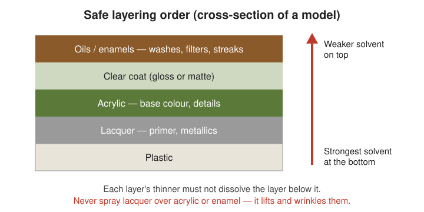
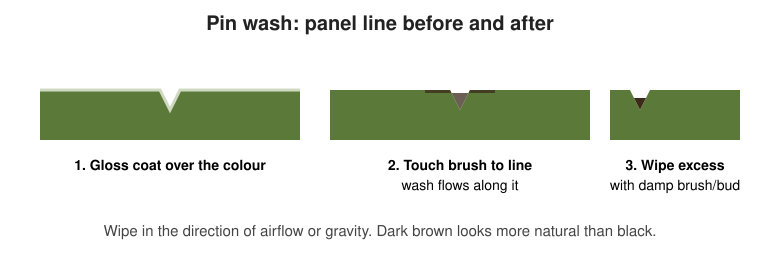
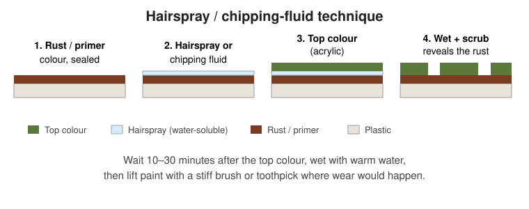
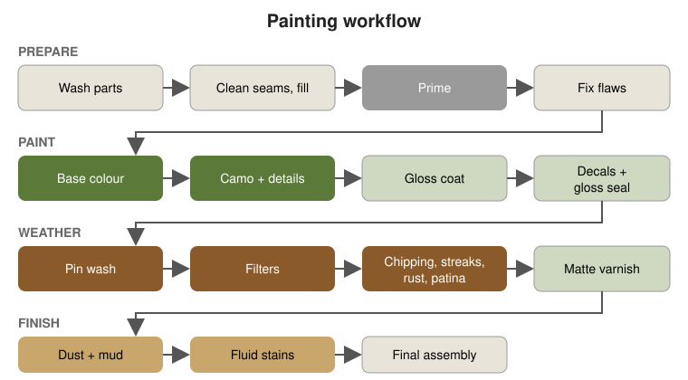

# Painting Plastic Models: A User Guide

A practical guide to painting and weathering plastic (polystyrene) scale models: preparation,
priming, base colours, washes, weathering, special effects such as rust and verdigris, and
the products modellers commonly use for each step.

Product names are examples that are widely available and well regarded, not endorsements. Ranges
change, so check the maker's current catalogue before buying.

Painting 3D prints (PLA, PETG) or Lexan RC bodies? Read
[Painting by Material](painting-by-material.md) first for preparation and primer.

## Contents

1. [Paint systems and why the order matters](#1-paint-systems-and-why-the-order-matters)
2. [Tools](#2-tools)
3. [Preparing the plastic](#3-preparing-the-plastic)
4. [Primer](#4-primer)
5. [Base colours](#5-base-colours)
6. [Metallics](#6-metallics)
7. [Gloss coat, decals and clear coats](#7-gloss-coat-decals-and-clear-coats)
8. [Washes and filters](#8-washes-and-filters)
9. [Weathering](#9-weathering)
10. [Special effects: rust, patina, verdigris and more](#10-special-effects-rust-patina-verdigris-and-more)
11. [Final coat and finishing](#11-final-coat-and-finishing)
12. [A complete workflow at a glance](#12-a-complete-workflow-at-a-glance)
13. [Troubleshooting](#13-troubleshooting)
14. [Health and safety](#14-health-and-safety)
15. [Shopping lists](#15-shopping-lists)
16. [Sources and further reading](#16-sources-and-further-reading)

---

## 1. Paint systems and why the order matters

Model paints fall into four families. The key rule: **a stronger solvent will attack a weaker
layer underneath it**, so you can layer techniques that use different solvents without
disturbing earlier work.

| Family | Thins / cleans with | Strength | Typical examples | Good for |
|---|---|---|---|---|
| Lacquer | Lacquer thinner | Strongest | Mr. Color, Mr. Surfacer, Tamiya LP, Alclad II, MRP | Primers, airbrushed base coats, metallics, hard varnishes |
| Enamel | White spirit / enamel thinner | Medium | Humbrol, Tamiya X/XF enamel line, AK/Ammo enamel washes | Washes, filters, streaking |
| Artist oil | Odourless mineral spirit (e.g. Turpenoid, Ammo Odourless Thinner) | Medium, very slow drying | Winsor & Newton, Abteilung 502, Ammo Oilbrushers | Dot filters, streaks, blending, wood grain |
| Acrylic (water-based) | Water or acrylic thinner | Weakest once cured, but resists oils/enamels | Vallejo Model Color / Model Air, Ammo Atom, AK 3rd Gen, Citadel, Tamiya X/XF (alcohol based) | Brush painting, details, chipping, most hobby painting |

**Safe layering order:** lacquer underneath → acrylic → enamel/oil on top. Enamel and oil
washes over acrylic are safe because their thinners don't dissolve cured acrylic; acrylic
over enamel is also usually fine. Lacquer over acrylic or enamel is **not** safe — it will
lift or wrinkle them.




Tamiya's acrylics are alcohol based and behave partly like a lacquer: they thin best with
Tamiya X-20A or Mr. Color Leveling Thinner, and isopropyl alcohol can strip them.

## 2. Tools

**Essentials**
- Sprue cutters, a sharp hobby knife (No. 11 blade), sanding sticks/sponges (400–2000 grit).
- Brushes: a fine pointed round (size 0–2) for details, a flat for washes/filters, an old
  stiff flat for dry-brushing and pigments. Synthetic is fine for acrylics; sable holds a point
  longer.
- Wet palette (for acrylics) and a ceramic or glass palette (for oils/enamels).
- Cotton buds, kitchen roll, toothpicks, masking tape (Tamiya tape in 6, 10 and 18 mm widths).
- Handles or crocodile clips on sticks to hold parts while painting.

**Worth adding**
- Airbrush (0.3 mm dual-action, e.g. Harder & Steenbeck, Iwata, or a budget Gaahleri/Fengda)
  and a compressor with a moisture trap and regulator. Spray at roughly 15–25 psi.
- Spray booth with extraction for lacquers and primers.
- Liquid masking fluid (Humbrol Maskol, Vallejo, Mr. Masking Sol), Silly Putty or Blu Tack for
  soft-edged camouflage.
- Make-up sponges, old toothbrush (for spattering), magnifier and good daylight lamp.

## 3. Preparing the plastic

Most paint problems start here.

1. **Wash the parts.** Moulds leave release agent on the plastic. Wash the sprues in warm water
   with a little washing-up liquid, rinse and let them dry. Afterwards handle parts with gloves
   or by the edges — skin oils stop paint adhering.
2. **Clean up.** Remove sprue gates, mould seams and flash with a knife and sanding sticks. Fill
   ejector-pin marks and gaps with putty (Tamiya Basic Putty, Mr. Dissolved Putty, Vallejo
   Plastic Putty) or superglue and sand smooth.
3. **Check seams before painting.** Wipe a seam with isopropyl alcohol or a quick coat of primer
   and look under raking light — primer reveals flaws, it does not hide them.
4. **Final wipe.** Just before priming, wipe or brush off dust. A wipe with isopropyl alcohol on
   a lint-free cloth removes fingerprints (test first on soft plastics).

## 4. Primer

### Why prime?

Primer gives paint something to grip, gives you a uniform colour to work over, and shows up
surface flaws you can still fix. It is especially important under metallics, under acrylics
(which bond poorly to bare styrene) and under any technique that involves masking or chipping.

### Types of primer

| Type | Products | Pros | Cons |
|---|---|---|---|
| **Lacquer** (spray can or airbrush) | Tamiya Fine Surface Primer (grey, white, light grey, pink, oxide red, black); Mr. Surfacer / Mr. Finishing Surfacer 1000/1200/1500; Mr. Base White 1000; MRP Fine Surface Primer | Very strong bond, thin, self-levelling, sands well; widely considered the toughest base | Strong fumes — needs ventilation/booth and a respirator; dislikes cold (<15 °C) and humidity |
| **Acrylic-polyurethane** (airbrush) | Badger Stynylrez, Vallejo Surface Primer, Ammo One Shot Primer, AK Primer | Low odour, safe indoors, thin and fairly tough once cured | Needs 24 h to cure fully; can tip-dry or clog the airbrush; weaker bond than lacquer |
| **Hobby spray cans (acrylic/enamel)** | Citadel/Army Painter spray primers, Rust-Oleum/Halfords plastic primer | Cheap, quick for large batches | Thicker coats can hide fine detail on small scales; car primers vary |

Mr. Surfacer numbers indicate grit: **500** fills scratches (brush on), **1000** is a
general-purpose filler primer, **1200/1500** are fine primers that keep detail. Tamiya Fine
Surface Primer L and Mr. Surfacer 1200 are roughly comparable and are the two most commonly
recommended choices.

### Choosing a colour

- **Grey:** neutral default; best for spotting flaws.
- **White:** under bright colours (yellow, red, orange, white) so they don't need many coats.
- **Black:** under metallics (gives depth and shine) and for dark subjects; also the start of
  "black basing".
- **Oxide red / red-brown:** under armour or ships to form a rust layer that chipping later
  reveals.
- **Pink / light grey:** under red or skin tones.

### How to apply

1. Shake cans for at least a minute; warm them in a bowl of warm (not hot) water in cold weather.
2. Spray 20–30 cm away in short passes, starting and stopping off the part.
3. Build up two or three **thin mist coats** rather than one wet one. You should still see the
   plastic through the first coat.
4. Let lacquer primer dry about an hour (overnight before sanding); acrylic-poly primers 24 h.
5. Inspect, fix flaws, sand lightly with 1500–2000 grit, re-prime the area.

**Pre-shading and black-basing** are optional next steps: spraying black along panel lines
(pre-shading), or priming black and building up the base colour in thin coats from the centre
of panels (black-basing), so the finished colour has natural variation.

## 5. Base colours

### Airbrushing

- Thin paint to roughly **semi-skimmed milk** consistency. Starting ratios: Tamiya acrylic
  1:1 with X-20A or Leveling Thinner; Vallejo Model Color 2:1 with Vallejo Airbrush Thinner
  (Model Air is pre-thinned and can be sprayed as is); Mr. Color 1:1–1:2 with Leveling Thinner.
- Spray at 15–20 psi, building colour in several light coats.
- Add a drop of **Vallejo Airbrush Flow Improver** or retarder to acrylics if they tip-dry.
- Clean the airbrush between colours and thoroughly at the end of the session.

### Brush painting

- Use a wet palette for acrylics so they stay workable.
- Thin with a little water or medium; two or three thin coats beat one thick one.
- Paint in one direction, let each coat dry, and don't go back over semi-dry paint.
- Vallejo Model Color, Ammo Atom, AK 3rd Generation and Citadel brush well; Tamiya acrylics
  brush poorly unless thinned with their retarder.

### Colour modulation and variation

Real surfaces are never one flat colour. Add variation by:
- lightening the base colour (add white/buff) toward the top and centre of panels;
- darkening it toward lower edges and recesses;
- spraying random light mottling of a slightly lighter or darker tone.

### Masking

- Tamiya tape for hard edges; burnish the edge with a toothpick.
- Blu Tack sausages or Silly Putty for semi-hard camouflage edges.
- Liquid mask for canopies, small odd shapes and chipping fluid tricks.
- Remove tape back over itself at a low angle while the paint is still slightly fresh.

## 6. Metallics

- **Prime in gloss black** (e.g. Alclad Gloss Black Base, Mr. Finishing Surfacer 1500 Black,
  Tamiya X-1 polished). The smoother the base, the shinier the metal.
- **Lacquer metallics** give the most realistic finish: Alclad II, Mr. Color Super Metallic 2,
  AK Xtreme Metal, MRP. Spray very thin.
- **Acrylic metallics**: Vallejo Metal Color (airbrush, very good), Ammo Atom metallics, AK 3rd
  Gen. Brush-painting is easiest with Vallejo Model Color metallics or Citadel.
- **Rub-on and buffing metals**: Uschi van der Rosten metal powders, Ammo/AK metal pigments,
  Vallejo Metal Color buffed, graphite pencil rubbed on edges (worn steel tracks, gun barrels).
- Mask metallics with low-tack tape only, and test on a hidden area first.

## 7. Gloss coat, decals and clear coats

Decals and washes both need a **smooth gloss surface**.

1. **Gloss coat** over the base colour: Tamiya X-22, Mr. Color GX100 Super Clear III, Alclad
   Aqua Gloss, Vallejo Gloss Varnish, Future/Pledge floor polish (Pledge Revive It).
2. **Decals:** soak, slide on, then use a setting solution so they conform to detail —
   Micro Set then Micro Sol, or Mr. Mark Setter then Mr. Mark Softer. Prick air bubbles with a
   pin and add more softener.
3. **Seal** the decals with another gloss coat, which also prepares the surface for washes.

## 8. Washes and filters

### Panel-line (pin) wash

A thin, dark paint applied with a fine brush into recesses; capillary action carries it along
panel lines and around rivets.




- **Products:** Tamiya Panel Line Accent Color (black, dark brown, grey), Ammo/AK enamel washes
  ("Dark Brown for Green Vehicles", "Africa Korps", "Tracks Wash"), Vallejo Model Wash
  (acrylic), Citadel shades (Nuln Oil, Agrax Earthshade), or artist oils thinned with odourless
  spirit.
- **Method:** over a gloss coat, touch the brush to the panel line; let it flash for 10–20 minutes;
  remove the excess with a cotton bud or flat brush barely damp with the same thinner, wiping in
  the direction of airflow or gravity.
- **Colour:** avoid pure black except on light colours or very dark models — dark brown or
  grey-brown usually looks more natural.

### Filters

A very thin, translucent coat of colour over the whole surface that shifts or unifies the tone
(for example an ochre filter warms a green tank; a blue filter cools a grey ship).

- **Products:** Ammo/AK filter ranges, Abteilung 502 oils heavily thinned, Tamiya enamels
  thinned 1:10.
- Work over a flat or satin coat, with a wide flat brush, avoiding pooling and tide marks.

### Dot filters

Place small dots of several artist oil colours (e.g. white, yellow ochre, blue-grey, red-brown)
over a panel, then blend them downward with a flat brush lightly dampened with odourless spirit
until only a faint colour shift remains. Clean the brush between passes so it doesn't turn
muddy. Works over acrylics and lacquers; over enamels, protect them first with a cured clear
coat.

## 9. Weathering

Weathering is about telling a story: where would dirt collect, rain run, crew walk, metal wear?
Look at reference photos, work in **thin layers** and stop early — it's easier to add than
to remove.

### Chipping

- **Sponge chipping:** tear a small piece of blister-pack foam or sponge, hold with tweezers,
  dip in dark brown/rust paint, dab most of it off on kitchen roll, then press lightly on edges,
  hatches and places of wear.
- **Brush chipping:** paint tiny irregular marks with a fine brush; add a lighter base-colour
  edge on the upper side of larger chips for depth.
- **Hairspray / chipping fluid:** spray rust or primer colour, seal, apply hairspray or a
  chipping fluid (Ammo Chipping Fluid, AK Worn Effects, Vallejo Chipping Medium), spray the top
  colour (acrylic), then after 10–30 minutes wet it with warm water and scrape/brush away paint
  to reveal the layer underneath. Excellent for winter whitewash and worn paint.


  

- **Salt masking:** dampen the surface, sprinkle rock salt, spray the top colour, then brush the
  salt away for random wear.

### Streaking and rain marks

- **Oils:** small dots of oil paint (rust, grime, buff) at the top of a panel, dragged down with
  a thin brush slightly dampened with spirit.
- **Products:** Ammo Streaking Grime, AK Streaking Grime, Rainmarks, Rust Streaks, Ammo
  Oilbrushers (oil paint in a bottle with a fine applicator brush).

### Dust, mud and dirt

- **Pigments** (Ammo, AK, MIG, Vallejo pigments, or chalk pastels scraped to powder): brush on
  over a flat finish, then fix with Pigment Fixer, white spirit or Vallejo Pigment Binder. They
  slip off gloss surfaces.
- **Splash mud:** flick thinned enamel/pigment mixes from a stiff brush or toothbrush.
- **Textured mud:** Ammo/AK Earth Effects, Vallejo Mud & Grass texture products, or a mix of
  pigment, plaster and acrylic gel — apply in layers, darker and wetter near the ground.
- **Dust:** a light airbrushed coat of thinned buff/tan (Tamiya XF-57 Buff, XF-52 Flat Earth)
  on lower surfaces.

### Fluids and stains

- **Fuel, oil and grease:** Ammo/AK "Fuel Stains", "Engine Oil", "Fresh Engine Oil" (glossy
  enamels). Apply around filler caps, engine decks, wheels. Use gloss for fresh, satin for old.
- **Exhaust and soot:** airbrush thinned Tamiya XF-64 Red Brown and XF-1 Black, or use black
  and rust pigments.

### Dry-brushing

Load an old stiff brush with a light colour, wipe almost all of it off, then flick lightly
across raised detail. Great for engines, tracks and figures; overdone, it looks chalky.

## 10. Special effects: rust, patina, verdigris and more

### Rust

1. **Base:** oxide-red or dark-brown primer, or a mottle of three or four rust colours (dark
   chocolate, red-brown, orange, light ochre) sponged or airbrushed.
2. **Rust washes:** Ammo/AK Rust Streaks, Light Rust Wash; Vallejo Model Wash Rust.
3. **Rust pigments:** Light Rust, Medium Rust, Old Rust from Ammo/AK/MIG/Vallejo, fixed with
   thinner or binder. Heavy rust can be built with pigment mixed into texture paste.
4. **Real rust kits:** chemical products that create real oxidation, e.g. AK's Rust Effect or
   iron-particle paints with an activator (Sophisticated Finishes Iron Paint + Rust Antiquing
   Solution). Results vary each time and control is limited — test on scrap first.

### Verdigris (green copper / bronze patina)

Verdigris forms on copper, brass and bronze — statues, roofs, propellers, fittings, cannons.

- **Painted method:**
  1. Paint the metal: brass/bronze/copper metallic, then darken recesses with a dark brown
     wash.
  2. Wash recesses with a thinned blue-green (e.g. Vallejo Model Color Blue-Green, Turquoise,
     or a mix of light green and white).
  3. Add drips and streaks of pale green running downward from raised detail.
  4. Re-highlight raised edges with the bare metal so the patina sits in the low areas.
- **Products:** AK Interactive Verdigris Wash (AK19313, acrylic, slow drying),
  Green Stuff World Patina Verdigris, Citadel Nihilakh Oxide (popular among figure painters),
  Ammo/AK "Verdigris" pigments.
- **Chemical method:** AK Interactive Verdigris Effect Set (AK11265) — paint the special bronze
  paint (also sold as AK11267 Bronze Effect), then apply the oxidising agent to grow real
  verdigris. Dilute the agent with water for subtler effects. Every result is different.

### Other patinas and effects

- **Weathered / sun-faded paint:** lighten the base colour on upper surfaces, then apply a
  light buff or white oil filter.
- **Heat-staining on exhausts:** spray translucent blue, then purple-brown, then tan rings with
  Tamiya Clear Blue + Clear Orange or Alclad Transparent colours over a steel base.
- **Burnished / worn metal:** graphite pencil or Uschi metal powders on edges and walk areas.
- **Wood:** base in light tan, drag a darker brown oil across with a stiff brush to create grain,
  then wash.
- **Aged canvas / tarpaulins:** dry-brush lighter tones, then streak and pigment the folds.
- **Snow and frost:** Ammo/AK Snow products, baking soda in white glue, or Vallejo Snow
  texture.
- **Water and wet effects:** Vallejo Still Water, AK Water Gel, and gloss varnish for wet mud.
- **Ice / dirty glass:** dust and streaking pigments on clear parts, masked windscreen wiper arcs.

## 11. Final coat and finishing

- Seal everything with a **matte or satin varnish** appropriate to the subject — Tamiya XF-86
  Flat Clear, Mr. Color GX113 Super Clear III Flat, Vallejo Matt Varnish (airbrush), AK Ultra
  Matte Varnish, or Testors Dullcote.
- Spray thin coats; heavy matte coats can frost (go white). Avoid high humidity.
- After the final varnish, add the final touches that should stay shiny or powdery: fresh fuel
  stains, glass, lights, last pigment dust.
- Unmask canopies, fit delicate parts (aerials, guns, mirrors), and attach to a base.

## 12. A complete workflow at a glance




```
Wash parts → Clean up seams → Prime → Fix flaws → Pre-shade/black-base (optional)
→ Base colour + modulation → Camouflage/masking → Details
→ Gloss coat → Decals → Gloss seal
→ Pin wash → Filters / dot filters
→ Chipping → Streaking → Rust / special effects
→ Matte varnish
→ Dust & mud pigments → Fluid stains → Final assembly → Base
```

## 13. Troubleshooting

| Problem | Likely cause | Fix |
|---|---|---|
| Paint peels when tape is removed | No primer, dirty plastic, tape too sticky | Wash parts, prime, de-tack tape on your hand |
| Grainy, rough finish | Spraying too far away, too thick, too dry, or too low pressure | Thin more, move closer, add retarder |
| Orange peel (lumpy) | Paint too thick, too much pressure | Thin more, lower pressure |
| Spidering / runs | Too wet, too close | Lighter coats, move further away |
| Frosting / white haze on matte varnish | Humidity or too heavy a coat | Spray in dry conditions; a gloss coat over it often clears it |
| Silvering decals | Decal over matte surface | Gloss coat before decals, use setting solution |
| Wash stains everything | Applied over matte paint | Gloss coat first, wipe sooner |
| Wash dissolves paint | Enamel thinner on enamel base | Use a different paint family, or seal with acrylic varnish |
| Tide marks from filters | Too much thinner, uneven drying | Blend edges while wet, less thinner |
| Airbrush spits | Tip-dry, dirty needle, paint too thick | Clean tip, flow improver, thin more |

## 14. Health and safety

- **Ventilation:** lacquers, lacquer thinners and spray cans release solvent vapours. Use a spray
  booth that vents outside, or spray outdoors.
- **Respirator:** wear a half-mask with **A2P3 (EU) / organic vapour + P100 (US)** cartridges
  when airbrushing or spraying anything, including acrylics — fine paint mist and pigments are
  bad for your lungs.
- **Gloves and eyes:** nitrile gloves for solvents and chemical effects; safety glasses when
  using chemical rust/verdigris kits.
- **Fire:** solvents are flammable; no naked flames. Let rags soaked in oil or thinner dry flat
  outside before disposal (oil-soaked rags can self-heat).
- **Pigments and dust:** don't blow loose pigment or sanding dust around; wipe up damp.
- **Disposal:** don't pour solvents down the drain; take them to a household chemical collection
  point.
- Keep paints, thinners and blades away from children and pets.

## 15. Shopping lists

### Starter (brush painting)

- Tamiya Fine Surface Primer (grey) spray can
- Vallejo Model Color starter set or the colours your kit needs
- Brushes: size 0 and 2 round, a 5 mm flat, an old flat for dry-brushing
- Wet palette, water pots, kitchen roll, cotton buds
- Tamiya Panel Line Accent Color (dark brown)
- Vallejo Gloss and Matt Varnish (brush-on), Micro Set and Micro Sol

### Intermediate (airbrush and weathering)

- Airbrush (0.3 mm), compressor with regulator and moisture trap, spray booth, respirator
- Mr. Surfacer 1200 or Tamiya Fine Surface Primer; Stynylrez for indoor use
- Tamiya acrylics + X-20A/Mr. Leveling Thinner, or Ammo Atom / Vallejo Model Air
- Alclad or Vallejo Metal Color for metallics
- Odourless mineral spirit; a basic set of oils (white, black, burnt umber, raw sienna,
  yellow ochre, a rust colour)
- Ammo/AK enamel washes, Streaking Grime
- Pigments: European Earth, Light Dust, Rust, Black Smoke, plus Pigment Fixer
- Chipping fluid or cheap hairspray

### Special-effects add-ons

- AK Verdigris Wash (AK19313) or Verdigris Effect Set (AK11265)
- Rust pigment set; a real-rust kit for experiments
- Water and snow effects; texture pastes for mud

## 16. Sources and further reading

Compiled from general modelling practice and the following references (accessed November 2026):

- FineScale Modeler — [Top 5 weathering techniques](https://finescale.com/how-to/online-extras/2021/09/top-5-weathering-techniques)
- FineScale Modeler — [Weathering with dot filters](https://finescale.com/online-extras/2021/04/weathering-with-dot-filters/)
- FineScale Modeler — [Using oil paints for streaks and grime](https://finescale.com/how-to/2023/06/using-oil-paints-for-streaks-and-grime)
- Scale Model Shop — [Weathering scale model kits](https://www.scalemodelshop.co.uk/weathering-scale-model-kits/)
- Scale Model Shop — [Lacquer vs acrylic primer for scale models](https://www.scalemodelshop.co.uk/lacquer-vs-acrylic-primer-scale-models/)
- Hobbyist Haven — [Primer for plastic scale models: what actually matters](https://hobbyisthaven.com/blogs/blog/primer-for-plastic-scale-models-what-actually-matters-and-what-doesnt)
- FineScale forum — [Best primer?](https://forum.finescale.com/t/best-primer/245727)
- Goonhammer — [How to paint everything: weathered copper, bronze and patina](https://goonhammer.com/how-to-paint-everything-weathered-copper-bronze-and-patina)
- AK Interactive — [Verdigris Wash AK19313](https://www.scalemodelshop.co.uk/ak-interactive-verdigris-wash/) and [Verdigris Effect Set AK11265](https://www.1001hobbies.co.uk/airbrush-paint/821011-ak-interactive-ak11265-ak-interactive-verdigris-effect-special-acrylic-paint-oxidizing-agent.html)
- Gaming Trend — [AK Interactive bronze and rust effects review](https://gamingtrend.com/reviews/ak-interactive-bronze-and-rust-effects-review-actual-weathering-in-a-bottle/)
- Green Stuff World — [Patina Verdigris](https://www.scalemodelshop.co.uk/gsw-patina-verdigris-5902/)
